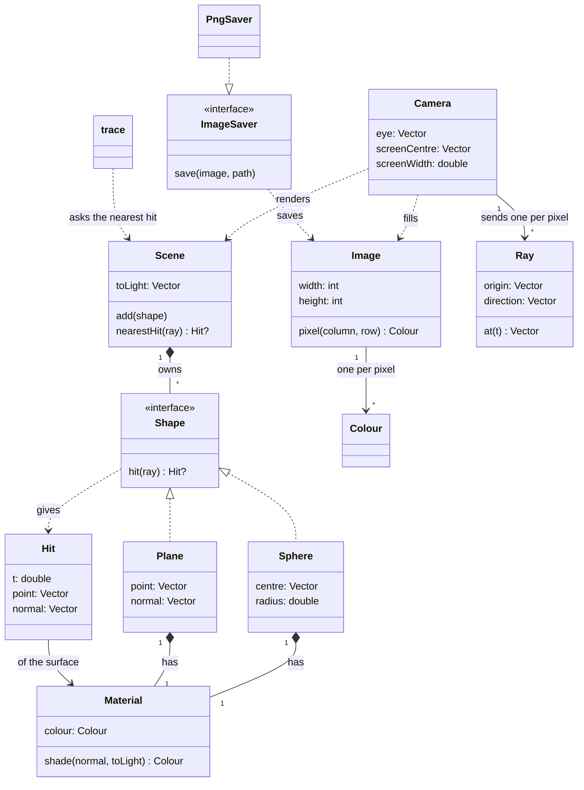

# Domain model

The concepts of the ray tracer and how they relate, taken from the client's explanation:

> We have a camera: an eye and a screen in front of it. The screen is divided into pixels. For each pixel, the camera sends a ray from the eye through the centre of the pixel. A ray has an origin and a direction, and both are vectors. We ask the sphere whether the ray hits it. A sphere has a centre, a radius and a colour. If the ray hits, the pixel takes the colour of the sphere. If not, it takes the colour of the sky. When every pixel has a colour, we have an image, and we save it to a file.

## Glossary

| Term | Meaning |
|---|---|
| Vector | Three numbers (x, y, z): a point or a direction in 3D |
| Ray | A half-line: an origin and a direction. Its points are `O + t * D`, for `t ≥ 0` |
| Camera | The eye, and the screen it looks through |
| Pixel | One square of the screen, and of the final image. Counted by column and row from the top left |
| Sphere | A centre and a radius, with a material |
| Plane | A point and a normal, with a material. The floor is one |
| Material | What a surface is made of: its colour, and how it takes the light |
| Normal | The unit vector a surface faces at a point. For a sphere, `(P − C) / r` |
| Sun | A light so far away that its direction, `toLight`, is the same everywhere |
| Scene | The shapes and the sun. It finds the nearest hit of a ray |
| Sky | The colour of a pixel whose ray hits nothing |
| Image | The grid of coloured pixels |
| Saver | Writes an image to a file. `PngSaver` writes PNG with LodePNG |

## Decisions so far

- A colour is a class of its own, not a Vector ([ADR 0007](../adr/0007-colour-class.md)).
- `trace(ray, scene)`, in `render/`, colours the pixel: the nearest hit, shaded by its material with Lambert's law, `max(0, N·L) × colour`, or black if the ray hits nothing.
- A shape has a material ([ADR 0010](../adr/0010-shape-has-a-material.md)). Every shape implements `Shape`, and the `Scene` owns them.
- `Camera::render` sends one ray per pixel through the scene and fills an `Image`. "The image saves itself" became "a saver saves it": `ImageSaver`, implemented by `PngSaver` ([ADR 0008](../adr/0008-png-output.md)).
- Coordinates: x right, y up, z forward, pixels from the top left ([ADR 0009](../adr/0009-coordinates.md)).
- A hit only counts in front of the ray's origin (`t > 0`). A ray that only touches the sphere counts as a hit, and so does a ray that starts inside it.

## Open questions

- Are a point and a direction the same class? Adding two points does not make sense.
- What should `normalised()` do with the zero vector `(0, 0, 0)`? Today it divides by zero. A ray with no direction makes no sense, so the check probably belongs where a ray is created.
- Should Colour keep r, g and b between 0 and 1? Lights will add colours past 1: clamp them, or refuse them?
- The sky is black and there are no shadows yet. Where does the sky colour live, and who casts a shadow ray?
- Materials will become an interface when mirrors or glass come. Should `Hit` then point to its material instead of copying it?
