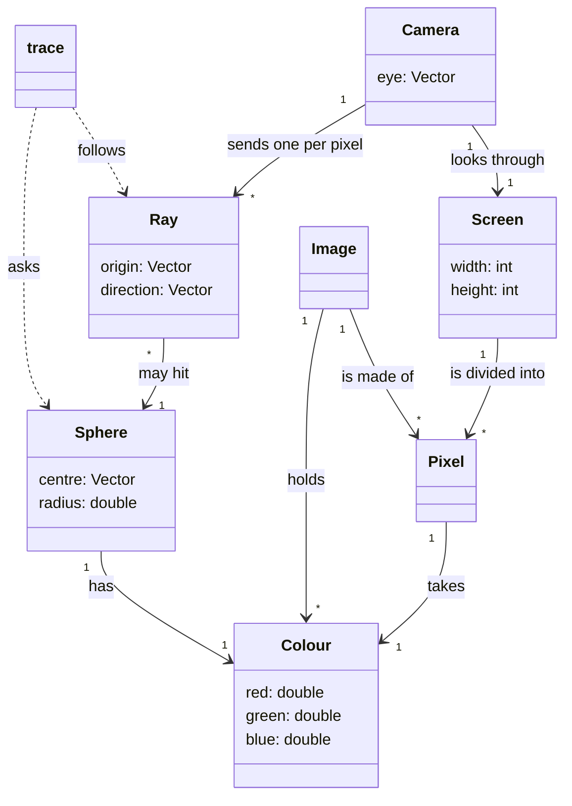

# Domain model

The concepts of the ray tracer and how they relate, taken from the client's explanation:

> We have a camera: an eye and a screen in front of it. The screen is divided into pixels. For each pixel, the camera sends a ray from the eye through the centre of the pixel. A ray has an origin and a direction, and both are vectors. We ask the sphere whether the ray hits it. A sphere has a centre, a radius and a colour. If the ray hits, the pixel takes the colour of the sphere. If not, it takes the colour of the sky. When every pixel has a colour, we have an image, and we save it to a file.

## Glossary

| Term | Meaning |
|---|---|
| Vector | Three numbers (x, y, z): a point or a direction in 3D |
| Ray | A half-line: an origin and a direction. Its points are `O + t * D`, for `t ≥ 0` |
| Camera | The eye, and the screen it looks through |
| Pixel | One square of the screen, and of the final image |
| Sphere | A centre and a radius, with a colour |
| Sky | The colour of a pixel whose ray hits nothing |
| Image | The grid of coloured pixels, saved to a file |

## Decisions so far

- A colour is a class of its own, not a Vector ([ADR 0007](../adr/0007-colour-class.md)).
- `trace(ray, sphere)`, in `render/`, colours the pixel: the sphere's colour if the ray hits it, black otherwise.
- A hit only counts in front of the ray's origin (`t > 0`). A ray that only touches the sphere counts as a hit, and so does a ray that starts inside it.

## Open questions

- Are a point and a direction the same class? Adding two points does not make sense.
- What should `normalised()` do with the zero vector `(0, 0, 0)`? Today it divides by zero. A ray with no direction makes no sense, so the check probably belongs where a ray is created.
- Should Colour keep r, g and b between 0 and 1? Lights will add colours past 1: clamp them, or refuse them?
- Which axes: x right, y up, z forward (left-handed, our choice so far), or looking along −z like *Ray Tracing in One Weekend* (right-handed)? It matters once pixel columns and rows become x and y.
