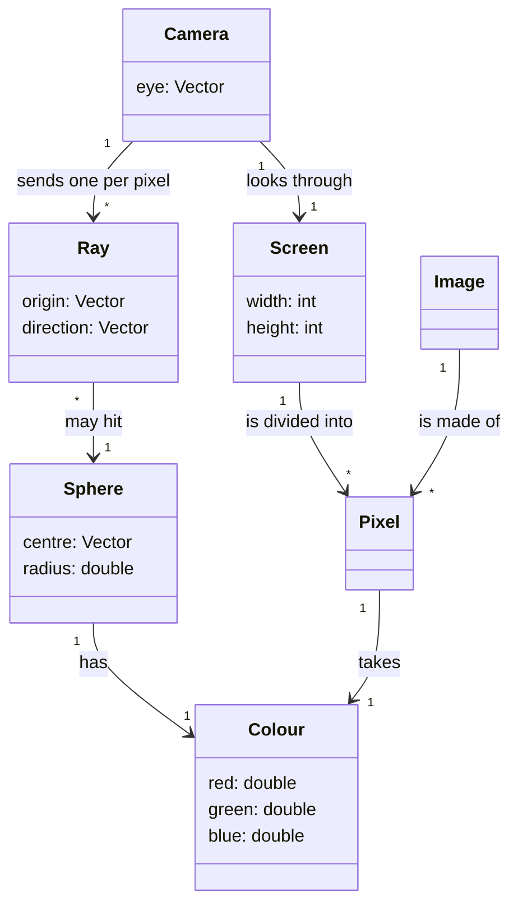

# Domain model

The concepts of the ray tracer and how they relate, taken from the client's explanation:

> We have a camera: an eye and a screen in front of it. The screen is divided into pixels. For each pixel, the camera sends a ray from the eye through the centre of the pixel. A ray has an origin and a direction, and both are vectors. We ask the sphere whether the ray hits it. A sphere has a centre, a radius and a colour. If the ray hits, the pixel takes the colour of the sphere. If not, it takes the colour of the sky. When every pixel has a colour, we have an image, and we save it to a file.

## Glossary

| Term | Meaning |
|---|---|
| Vector | Three numbers (x, y, z): a point or a direction in 3D |
| Ray | A half-line: an origin and a direction. Its points are `O + t * D`, for `t ≥ 0` |
| Camera | The eye, and the screen it looks through |
| Pixel | One square of the screen, and of the final image |
| Sphere | A centre and a radius, with a colour |
| Sky | The colour of a pixel whose ray hits nothing |
| Image | The grid of coloured pixels, saved to a file |

## Open questions

These are design decisions, recorded in an ADR once settled:

- Is a colour a vector? It is three numbers too, but adding two colours does not mean what adding two directions means.
- Are a point and a direction the same class? Adding two points does not make sense.
- Who decides the colour of a pixel: the camera, the image or the main program?
